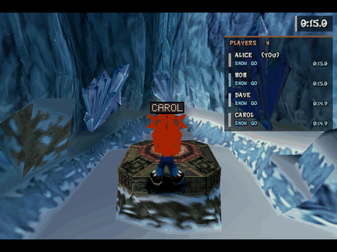
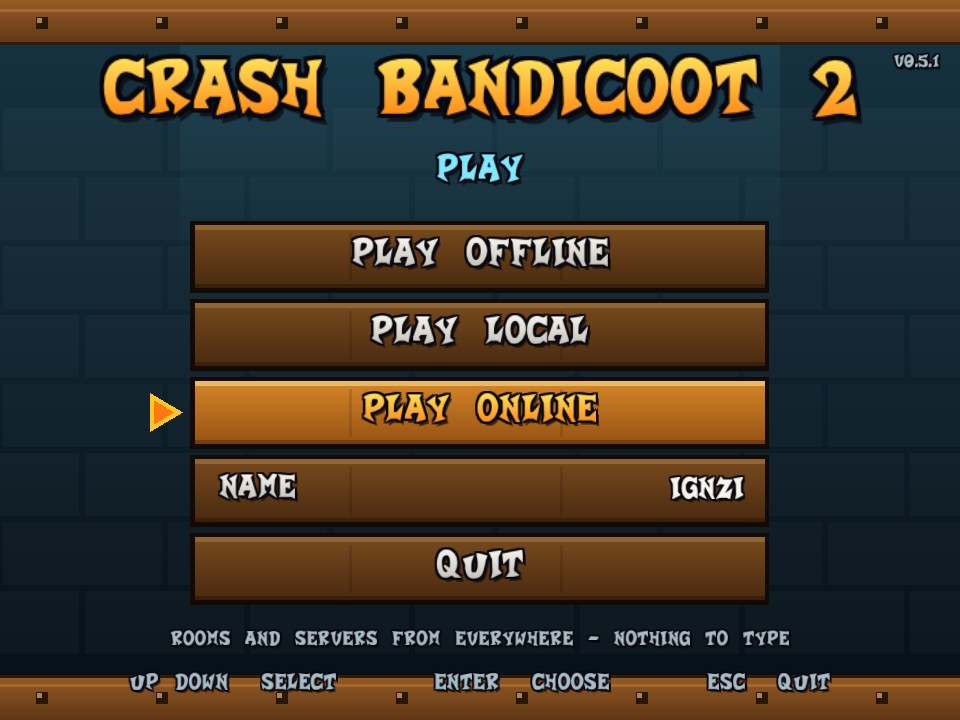
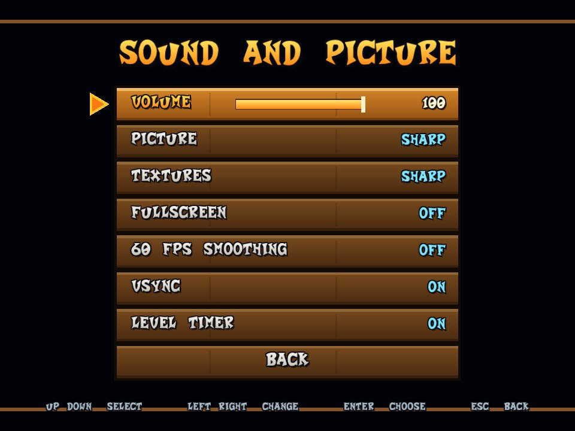
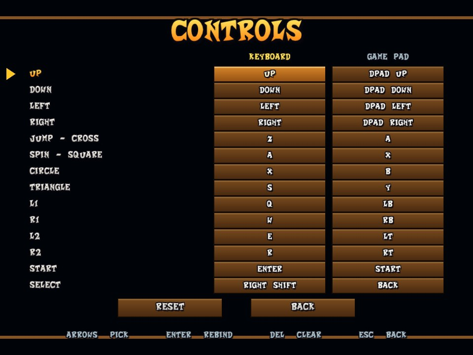

# CB2-Online

**Crash Bandicoot 2 with online multiplayer.** Play the original game, level by level, together with your friends: everybody who is in the same
room appears in your game as an extra Crash with a name tag, in the same level, in real time. Add level timers and personal records, a live
player list, 60 fps smoothing and an in-game menu, and you have a game built for racing and speedrunning together.

<p align="center"></p>

> **You need your own copy of the game.** CB2-Online contains no game data: on the first start it asks for **your own disc image** of Crash Bandicoot 2
> (NTSC-U, `SCUS_941.54`) and copies the files it needs. See [Install](#install) and [NOTICE.md](NOTICE.md).

**Contents:** [Features](#features) · [Install](#install) · [Playing online](#playing-online) · [Controls](#controls) · [In-game menu](#in-game-menu) ·
[Level times and records](#level-times-and-records) · [Graphics and speed](#graphics-and-speed) · [Save states](#save-states) · [Settings](#settings-cb2cfg) ·
[Updates](#updates) · [How it works](#how-it-works) · [For developers](#for-developers) · [Known limits](#known-limits) · [Legal](#legal)

## Features

**Multiplayer**
- Play with friends in the **same level at the same time**: every other player is a real Crash in your game, with animation, position and a floating name tag.
- **No host, no port forwarding, no addresses to type.** Players in a room find each other on the same PC or network automatically, or through a
  rendezvous server on the internet; they can leave and come back at any time.
- **Online lobby** before the game: play offline, play on your network, or play online; your name; a public list of open rooms and servers.
- **Player list** at the right edge: who is online, which level each one is in, how long they have been in it, their best time and latest finish (`F3`).
- **Notices** when somebody joins or leaves the room, enters or leaves a level, finishes a level or runs out of lives.
- **Opacity slider** for the other players' Crashes (10-100%), so they do not block your view.
- Others are shown, not solid: you do not collide with them or interact. Online, they see you standing still while your menu is open.

**Speedrunning**
- **Level timer** from the first frame Crash can move until the level ends (`F4`), in the game's own 59.94 Hz time.
- **Personal records** per level, saved in `records.txt`; a *Records* page in the menu; new-best notices.
- Your best time and latest finish are **shared with the room**. A server-side leaderboard is planned: [SPEEDRUN.md](docs/SPEEDRUN.md).
- **Save states** (`F5` save, `F9` load, four slots): practise a trick without replaying the cutscenes.
- Hold `Tab` to fast-forward.

**Graphics and sound**
- **OpenGL renderer** at up to 8x the original resolution (default 4x) with unrounded vertex positions, so the geometry does not wobble.
- **60 fps smoothing** (optional): the game draws 30 pictures per second; this draws the pictures in between.
- **Smooth textures** (optional): bilinear filtering instead of the blocky texels. **Perspective-correct textures** (optional): no more swimming textures on floors and walls.
- **Native world** (optional, experimental): the level scenery is drawn by OpenGL straight from the level files, with a depth buffer and perspective-correct textures, instead of from the polygons the console's code projected. It is what makes widescreen show real geometry in the side margins, and it moves the camera exactly for the 60 fps pictures in between. Water and other see-through polygons stay the game's own.
- **Widescreen** (optional): the picture at your window's aspect ratio (see the limits below).
- **High refresh rates:** with 60 fps smoothing on a 90+ Hz monitor every refresh shows its own picture (160 Hz = 160 distinct pictures a second).
- Display filters (nearest / bilinear / sharp bilinear), fullscreen, vsync, 4:3 picture whatever the window shape.
- Volume slider; the original sound and music.

**Bug reports**
- Esc → **Report a bug** opens a GitHub issue in your browser with your version, system, graphics card, settings and the last crash filled in. Nothing is sent until you press Submit.
- If the game crashes it writes `crash.log` next to the game (what failed, where, the game's state). If it vanishes without an error (killed, graphics driver reset) the next start notices that too. Either way, the next start offers to open the bug report for you; the log is kept as `crash-last.log`.

**Controls**
- Keyboard, game pad (XInput / SDL mapping) and mouse; every PS1 button is **rebindable** for both keyboard and pad, side by side in the menu.

**Convenience**
- **Fast loading:** zones and levels load in a fraction of a second (the emulated disc drive is 16 times faster than the console's; `disc_speed` in `cb2.cfg`).
- **In-game menu** (`Esc`): sound and picture, online options, records, controls, back to the main menu, quit.
- **Automatic updates** from GitHub Releases, verified by SHA-256; your files and saves are untouched.
- **Disc importer**: point it at your `.cue` / `.bin` / `.iso` once; it extracts what it needs.
- Memory card saves in the standard 128 KiB image format (`memcard0.mcr`).
- Works as a single folder you can copy; the optional server is a separate small program for Windows and Linux.

**For modders and developers**
- Mod folders that overlay files onto the disc (`--mod`), NSF/NSD level reader and writer, a GOOL script assembler, a scenery-to-OBJ pipeline, a level
  viewer. See [For developers](#for-developers).

## Install

1. Download `CB2-Online-v<version>.zip` from the [Releases](../../releases) page and unzip it anywhere.
2. Run `Play.bat` (or `Crash2.exe`).
3. **First start only:** the game asks for your disc image. Pick the `.cue` (or `.bin` / `.iso`) of your Crash Bandicoot 2 (NTSC-U) disc; it copies the
   files it needs into the `data` folder, once. You can also drop the `.cue` / `.iso` on `Crash2.exe`, or run `Crash2.exe --import "path\to\disc.cue"`.
   Compressed formats (`.chd`, `.pbp`, `.ecm`) are not supported. If you already have the files extracted, copy `SCUS_941.54`, `SYSTEM.CNF` and the
   `S0` .. `S3` folders into `data` yourself.
4. The lobby opens. Choose **Play Online**, or **Play Offline** to play alone.

The folder holds your own game files, so keep it for yourself; the release zip itself never contains them.

```
Crash2.exe            the game
data\                 your game files (SCUS_941.54, SYSTEM.CNF, S0..S3), found automatically
states\               your save states
cb2.cfg               settings (name, room, server, picture ...)
memcard0.mcr          your game saves; records.txt: your level records
Crash2-Server.exe     rendezvous server (no game inside), only needed to host one
*.bat                 shortcuts: play, play offline (no lobby), start the server
```

## Playing online

1. Start the game and pick **Play Online** in the lobby. Type nothing: you get into the public room.
2. Everybody who chose the same room is in your game from then on. To play with specific friends, put the same room name in your `cb2.cfg`
   (`room = MYFRIENDS`) or start with `Crash2.exe --room MYFRIENDS`.
3. Walk into the same level. You see each other; the player list (`F3`) shows who is where.

| Way of playing | When to use it |
| --- | --- |
| **Play Offline** | alone; nothing is sent anywhere |
| **Play Local** | everybody is on the same PC or the same network: players find each other by themselves |
| **Play Online** | over the internet: the lobby service lists open rooms and servers, and a rendezvous server introduces the players (it never carries the game) |

Hosting your own rendezvous server, the lobby service and the network protocol are described in [docs/ONLINE.md](docs/ONLINE.md) and
[docs/LOBBY_PROTOCOL.md](docs/LOBBY_PROTOCOL.md). Command line: `--online`, `--room NAME`, `--rendezvous host:port`, `--name NAME`, `--no-lobby`.

<p align="center"></p>

## Controls

| Key | Action | | Key | Action |
| --- | --- | --- | --- | --- |
| Arrows | D-pad | | `Esc` | in-game menu |
| `Z` | Cross (jump) | | `F1` | cycle display filter |
| `X` | Circle | | `F3` | show / hide the player list |
| `A` | Square (spin) | | `F4` | show / hide the level timer |
| `S` | Triangle | | `F5` / `F9` / `F6` | save state / load state / next slot |
| `Q` `W` `E` `R` | L1 R1 L2 R2 | | `F11` | fullscreen |
| `Enter` / Right Shift | Start / Select | | `F12` | screenshot |
| Hold `Tab` | fast-forward | | `F2` | toggle the OpenGL renderer |

A game pad works as well (left stick = D-pad). Everything is rebindable in the menu.

## In-game menu

`Esc` pauses the game and opens the menu. It works with keyboard, game pad and mouse: arrows / D-pad / hover to pick, `Enter` / A / click to choose,
Left-Right or dragging to move a slider, `Esc` / B / right click to go back.

| Page | What is on it |
| --- | --- |
| **Sound and picture** | volume, display filter, fullscreen, level timer |
| **Graphics** | **textures** (sharp / smooth), **perspective** correction, **native world**, **widescreen**, **60 fps smoothing**, vsync |
| **Online** | name tags, **opacity of the other players**, the player list |
| **Records** | your best time and runs per level |
| **Controls** | keyboard and game pad bindings side by side; `Enter` rebinds, `Del` clears, a key already in use swaps |
| **Main menu** | leave the room and return to the lobby (progress not saved on the memory card is lost) |
| **Quit** | close the game |

<p align="center"> </p>

## Level times and records

A timer at the top right times each level from the moment Crash can move until the game leaves the level. Finished runs become **personal records**
(`records.txt`, listed on the menu's *Records* page); running out of lives is counted as an attempt, never as a record. Everybody in the room sees
your best time for the level you are in and your latest finish. Details, the file format and the leaderboard plans: [docs/SPEEDRUN.md](docs/SPEEDRUN.md).

## Graphics and speed

- **Resolution:** `scale = 4` in `cb2.cfg` (1-8) is the multiple of the original resolution.
- **60 fps smoothing:** draws a picture between each pair of the game's 30 fps frames by moving every polygon half way to where it was in the previous frame.
  Adds one vblank (about 17 ms) of delay; the game's own timing is unchanged. Off by default.
- **Textures: smooth:** bilinear texture filtering in the shader, without bleeding between neighbouring textures. Default is the original sharp look.
- **Speed:** the emulator skips the engine's idle waiting, which halves its CPU use; frame pacing and vsync are tuned for an even rhythm.
- **Fast loading:** the emulated disc drive is 16 times faster than the console's, so a zone or level load takes 0.2-0.3 s instead of 2.5-5 s (`disc_speed = 1` in `cb2.cfg` for the authentic waits).

All of it, with the reasoning and how to measure it, is in [docs/PERFORMANCE.md](docs/PERFORMANCE.md).

## Save states

`F5` saves the whole game (all of the emulated console) into the current slot, `F9` loads it, `F6` switches between slots 1-4. Files: `states\slotN.cb2state`.
Useful for practice and for reproducing bugs without replaying the cutscenes. They do not touch your memory card saves, they are not portable between versions that
change the console emulation, and they only work with the normal (interpreter) engine.

## Settings (`cb2.cfg`)

Everything in the menu is remembered in `cb2.cfg` next to `Crash2.exe`; the file is plain text (`key = value`). The main keys:

| Key | Meaning |
| --- | --- |
| `name`, `room` | your name above your Crash; the room you meet people in |
| `scale` | internal resolution multiplier (1-8) |
| `volume`, `filter`, `timer` | the *Sound and picture* page |
| `textures`, `perspective`, `native_world`, `widescreen`, `smooth`, `vsync`, `refresh_rate` | the *Graphics* page (`refresh_rate = 0` uses your monitor's rate) |
| `disc_speed` | how many times faster than the console's drive the game's disc reads are (1-24, default 16) |
| `nametags`, `opacity`, `roster` | the *Online* page |
| `key_<button>`, `pad_<button>` | bindings |
| `rendezvous`, `directory` | rendezvous server and lobby service (built in; set only to override) |
| `update = off`, `lobby = off` | no update check; no lobby |

The full list is documented at the top of [src/config.hpp](src/config.hpp) and in `cb2.cfg.example`.

## Updates

When the lobby opens, the game checks this project's GitHub Releases for a newer version (one request, in the background). If there is one, the first row
becomes *UPDATE TO Vx.y.z*; choosing it downloads the new `Crash2.exe`, verifies its SHA-256 and restarts. Your game files, settings and saves are not
touched. `update = off` disables the check. How releases are made: [docs/RELEASING.md](docs/RELEASING.md).

## How it works

CB2-Online does not remake the game: it runs the **original game code and its scripts unmodified** on a PlayStation platform layer written in C++
(R3000 CPU, exact GTE, GPU, SPU, CD-ROM, memory card, BIOS replacement), with an OpenGL window, audio and input. Online play hooks the game's own
object routines: other players are created as extra Crash objects, fed with the positions and animations that arrive over UDP, and drawn by the
game's own code. Details: [docs/ONLINE.md](docs/ONLINE.md), [docs/PLATFORM.md](docs/PLATFORM.md), [docs/ARCHITECTURE.md](docs/ARCHITECTURE.md).

## For developers

Building (Windows, Visual Studio 2022 + CMake), the command line, the test suite, the modding pipeline (NSF/NSD, GOOL, scenery), the research tools and the
status of every part of the engine layer are in **[docs/DEVELOPMENT.md](docs/DEVELOPMENT.md)**.

```
cmake -S . -B build -G "Visual Studio 17 2022" -A x64
cmake --build build --config Release
```

## Known limits

- Other players are shown, not solid: no collision and no shared crates or enemies.
- Widescreen shows only what the game itself draws beyond its 4:3 view, so the new side margins can be empty at some edges. There is no PGXP depth buffer, and the renderer is OpenGL only (no Vulkan or DX12; the renderer is not the bottleneck).
- The end of a level is detected through the game's own "go to the next level" request; it is verified for entering a level, and a real level end has not been
  captured yet ([docs/SPEEDRUN.md](docs/SPEEDRUN.md)). Please report a finished level that is not counted.
- Loads are about 15 times shorter than on a console (`disc_speed`); what remains is the game's own work. If you still see a freeze, run with `CB2_FRAMELOG=1` and send the log.
- The game uses no CD audio, reverb, noise or pitch modulation in anything tested; reverb is implemented anyway (
everb = off to leave it out), noise and pitch modulation are not.
- Versions 0.3 and 0.4+ do not see each other online (the network format changed in 0.4).

## Legal

Source code: MIT ([LICENSE](LICENSE)). **This repository contains no game data**: you need your own legally obtained copy of Crash Bandicoot 2. Crash Bandicoot
is a trademark of its owners; this is a fan project with no connection to them. See [NOTICE.md](NOTICE.md).
